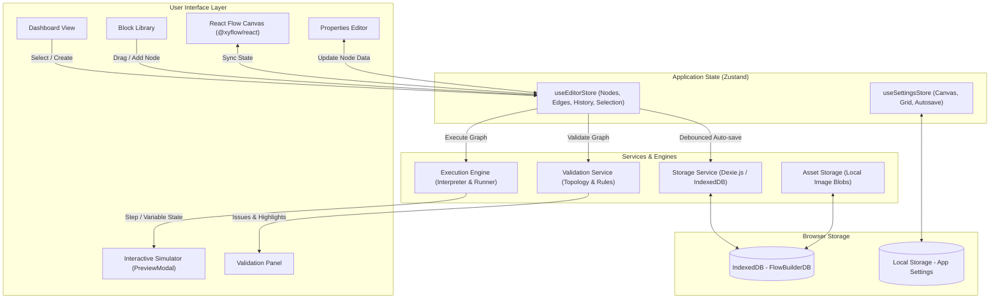

# Visual Flow Builder

[](https://react.dev/)
[](https://www.typescriptlang.org/)
[](https://vitejs.dev/)
[](https://reactflow.dev/)
[](https://github.com/pmndrs/zustand)
[](https://dexie.org/)
[](https://tailwindcss.com/)
[](https://vitest.dev/)

A production-grade, offline-first Visual Flow Builder web application. Design, validate, test, and execute complex conversational flows, interactive bot journeys, and automated workflows right inside the browser—with zero server dependency, instant local persistence via IndexedDB, and real-time execution simulation.

---

## Table of Contents

- [Overview](#overview)
- [Key Features](#key-features)
  - [1. Dashboard & Lifecycle Management](#1-dashboard--lifecycle-management)
  - [2. Three-Panel Visual Canvas Editor](#2-three-panel-visual-canvas-editor)
  - [3. Comprehensive Block Catalog (35+ Node Types)](#3-comprehensive-block-catalog-35-node-types)
  - [4. Interactive Execution & Simulation Engine](#4-interactive-execution--simulation-engine)
  - [5. Graph Validation & Health Engine](#5-graph-validation--health-engine)
  - [6. Offline-First Storage & Asset Management](#6-offline-first-storage--asset-management)
- [Architecture & Data Flow](#architecture--data-flow)
- [Technology Stack](#technology-stack)
- [Project Structure](#project-structure)
- [Keyboard Shortcuts](#keyboard-shortcuts)
- [Getting Started](#getting-started)
  - [Prerequisites](#prerequisites)
  - [Installation](#installation)
  - [Development Server](#development-server)
  - [Building for Production](#building-for-production)
  - [Testing](#testing)
- [Configuration & Settings](#configuration--settings)
- [Workflow JSON Schema](#workflow-json-schema)
- [License](#license)

---

## Overview

Visual Flow Builder provides an intuitive, node-based visual programming environment tailored for conversational interfaces, interactive wizards, branching logic, and automated workflows.

Built on top of `@xyflow/react` (React Flow v13) and React 19, the editor features drag-and-drop node instantiation, custom handle routing, deep multi-field property editing, live graph topology analysis, an integrated step-by-step debugger, and instant client-side persistence powered by Dexie.js (IndexedDB).

---

## Key Features

### 1. Dashboard & Lifecycle Management
- **Workflow Catalog**: View all created workflows in clean cards detailing node count, edge count, category badges, and last modified timestamps.
- **Search & Filter**: Real-time keyword search across names and descriptions, coupled with instant filtering by categories (*General*, *Chatbot*, *Automation*, *Decision Flow*, *Lead Generation*, *Onboarding*).
- **Sorting Options**: Sort by Recently Modified, Date Created, or Alphabetical (A-Z).
- **Workflow Operations**: Inline title editing, one-click duplicate/clone, individual workflow JSON export, and confirmation-gated deletion.
- **Portability & Backups**: Import standalone workflow JSON files or manage full-system database backups (export all workflows, restore backups, or wipe local database).

### 2. Three-Panel Visual Canvas Editor
- **Left Panel — Block Library**:
  - Categorized, collapsible palette of all 35+ available node types.
  - Real-time search filter to quickly find nodes by name or category.
  - Dual insertion modes: Drag-and-drop anywhere onto the canvas, or click to insert at the center of your current viewport.
- **Center Panel — Visual Flow Canvas**:
  - Full pan, zoom, fit-view, and center-canvas controls.
  - Configurable background grid with grid-snapping options.
  - Interactive Minimap for birds-eye navigation across large workflows.
  - Custom colored handles with automatic connection validation.
  - Right-click context menu (copy, duplicate, delete, inspect).
  - Multi-node rubberband marquee selection and batch translation.
  - Undo / Redo history management with dedicated action stacks.
- **Right Panel — Properties Inspector**:
  - Live two-way synchronized property editing without modal interruptions.
  - Context-aware display: displays global workflow metadata and statistics when nothing is selected; switches to node-specific attributes, connection diagnostics, and actions when a node is selected.

### 3. Comprehensive Block Catalog (35+ Node Types)

The node library covers 6 dedicated functional categories:

| Category | Node Types | Purpose & Capabilities |
| :--- | :--- | :--- |
| **Basic Content** | `Start`, `End`, `Text`, `Heading`, `Image`, `Video`, `Audio`, `File`, `Divider` | Core presentation elements. Supports markdown/rich text, typography levels, local IndexedDB image storage + external URLs, audio/video streaming, and attachments. |
| **Conversational Messages** | `Text Message`, `Image + Text`, `Video + Text`, `Text + Button`, `Image + Text + Button`, `Multiple Buttons`, `List Message`, `Card Message`, `Carousel Message`, `Document + Text` | Rich messaging components designed for chatbots, WhatsApp, Telegram, or Webchat agents. Supports quick-replies, interactive buttons, item lists, and card carousels. |
| **Interactive & Inputs** | `Single Choice`, `Multiple Choice`, `Question`, `User Input`, `Form`, `Contact Info`, `Date Selection`, `Rating`, `Confirmation` | User input collection and conversational branch branching. Features multi-input form builders, validation rules (email, phone, dates), 5-star ratings, and boolean confirmations. |
| **Flow Control** | `Navigation`, `Connect Flow`, `Delay`, `Redirect`, `Subflow`, `Button`, `Link` | Journey orchestration. Timed delays, branching jumps, external URL redirects, and subflow modularization. |
| **Logic & State** | `Condition`, `If/Else`, `Switch`, `Variable`, `Calculation`, `Merge` | Dynamic business logic. Mutate runtime variables, perform math operations (`+`, `-`, `*`, `/`, `%`), branch using multi-case switches, and converge multi-branch flows. |
| **Integrations & Scripts** | `API Request`, `Webhook`, `JavaScript` | Extensibility layer. Execute HTTP REST calls (GET/POST/PUT/DELETE) with custom headers and parameters, trigger webhooks, or evaluate sandboxed JavaScript snippets with runtime state access. |

### 4. Interactive Execution & Simulation Engine
- **Live Simulator**: Test and experience workflows exactly as an end-user would in an interactive mobile/chat preview frame.
- **Step-by-Step Traversal**: Debug flows with manual step controls (`Next Step`, `Previous Step`, `Pause`, `Restart`).
- **Runtime Variable State Inspector**: Real-time table tracking all session variables, mutations, user responses, and calculation outcomes.
- **Activity & Execution Log**: Comprehensive timestamped log detailing node transitions, evaluated conditions, API responses, and execution durations.

### 5. Graph Validation & Health Engine
- **Structural Integrity**: Ensures valid flow topology (detects missing `Start` node, illegal duplicate `Start` nodes, or missing `End` node).
- **Reachability & Connectivity**: Flags orphaned nodes, unreachable subgraphs, and dead-end paths.
- **Property Audits**: Identifies unconfigured URLs, empty text payloads, unassigned variable names, or missing calculation operands.
- **Interactive Issue Navigator**: Click any warning or error in the validation drawer to instantly auto-pan and zoom the canvas directly onto the problematic node.

### 6. Offline-First Storage & Asset Management
- **Local Persistence via Dexie.js**: All workflows, canvas coordinates, viewport states, and node configurations persist in client-side IndexedDB.
- **Binary Asset Storage**: Uploaded local images are stored directly in a dedicated IndexedDB asset store and served via blob object URLs.
- **Debounced Auto-Save**: Background autosave ensures your canvas changes are continuously safeguarded without lag.
- **System Backup & Restore**: Full JSON backup facility in the Settings page to export or restore the entire database.

---

## Architecture & Data Flow



---

## Technology Stack

- **Core Framework**: [React 19](https://react.dev/) + [TypeScript](https://www.typescriptlang.org/)
- **Bundler & Tooling**: [Vite 6](https://vitejs.dev/)
- **Canvas Engine**: [@xyflow/react v13](https://reactflow.dev/) (React Flow)
- **State Management**: [Zustand v5](https://github.com/pmndrs/zustand)
- **Local Database**: [Dexie.js v4](https://dexie.org/) (IndexedDB wrapper)
- **Routing**: [React Router v7](https://reactrouter.com/)
- **Styling**: [Tailwind CSS v3](https://tailwindcss.com/) with strict flat design guidelines
- **Icons**: [Lucide React](https://lucide.dev/)
- **Data Validation**: [Zod v4](https://zod.dev/)
- **Testing**: [Vitest](https://vitest.dev/), [@testing-library/react](https://testing-library.com/), [fake-indexeddb](https://github.com/dumbmatter/fakeIndexedDB), [Playwright](https://playwright.dev/)

---

## Project Structure

```text
flow-builder/
├── e2e/                             # Playwright end-to-end test suites
│   └── workflow-builder.spec.ts     # Complete user lifecycle E2E tests
├── public/                          # Static assets and favicon
│   └── favicon.svg                  # Application favicon
├── src/
│   ├── __tests__/                   # Unit & integration test suites
│   │   ├── editorStore.test.ts      # Canvas state & history tests
│   │   ├── executionEngine.test.ts  # Graph traversal & execution tests
│   │   ├── setup.ts                 # Test environment & IndexedDB mocks
│   │   ├── validationService.test.ts# Topological validation tests
│   │   └── workflowStorage.test.ts  # Database persistence tests
│   ├── components/
│   │   ├── common/                  # Reusable modals (ConfirmModal, ErrorBoundary, KeyboardShortcuts)
│   │   ├── dashboard/               # Dashboard cards, modals, and empty state
│   │   ├── editor/                  # Canvas, BlockLibrary, Toolbar, PropertiesEditor, ContextMenu
│   │   ├── nodes/                   # Custom React Flow node components for all 35+ types
│   │   └── ui/                      # Accessible UI primitives (Button, Input, Select, Switch, Dialog, Toast)
│   ├── constants/
│   │   └── blockDefinitions.ts      # Node schemas, default data, and input/output socket metadata
│   ├── db/
│   │   └── database.ts              # Dexie IndexedDB schemas and migrations
│   ├── pages/
│   │   ├── DashboardPage.tsx        # Workflow gallery, search, filters, import/export
│   │   ├── EditorPage.tsx           # Three-panel visual builder page
│   │   └── SettingsPage.tsx         # User preferences, backup & restore, database reset
│   ├── services/
│   │   ├── assetStorage.ts          # IndexedDB blob management for media
│   │   ├── executionEngine.ts       # Step-by-step flow interpreter & session runtime
│   │   ├── validationService.ts     # Graph health and structure checker
│   │   └── workflowStorage.ts       # Workflow CRUD and JSON serialization
│   ├── store/
│   │   ├── useEditorStore.ts        # Main editor store (nodes, edges, undo/redo, selection)
│   │   └── useSettingsStore.ts      # Settings store (grid, zoom, autosave preferences)
│   ├── types/
│   │   ├── execution.ts             # Runtime execution and variable types
│   │   ├── validation.ts            # Diagnostic issue severity and category types
│   │   └── workflow.ts              # Node, Edge, Category, and Payload definitions
│   ├── App.tsx                      # Application routing and providers
│   ├── index.css                    # Tailwind CSS base and custom canvas styles
│   └── main.tsx                     # Application bootstrap
├── package.json
├── playwright.config.ts             # Playwright browser testing configuration
├── tailwind.config.js               # Design tokens and Tailwind configuration
├── tsconfig.json                    # TypeScript compiler configuration
├── vite.config.ts                   # Vite build configuration
└── vitest.config.ts                 # Vitest test runner configuration
```

---

## Keyboard Shortcuts

The visual canvas supports standard productivity shortcuts:

| Shortcut | Action | Description |
| :--- | :--- | :--- |
| <kbd>Ctrl</kbd> + <kbd>S</kbd> | Save Workflow | Manually trigger immediate persistence to IndexedDB |
| <kbd>Ctrl</kbd> + <kbd>Z</kbd> | Undo | Revert previous canvas action, move, or edit |
| <kbd>Ctrl</kbd> + <kbd>Shift</kbd> + <kbd>Z</kbd> / <kbd>Ctrl</kbd> + <kbd>Y</kbd> | Redo | Reapply previously undone action |
| <kbd>Ctrl</kbd> + <kbd>C</kbd> | Copy | Copy currently selected node(s) to internal clipboard |
| <kbd>Ctrl</kbd> + <kbd>V</kbd> | Paste | Paste copied node(s) with offset coordinates |
| <kbd>Ctrl</kbd> + <kbd>D</kbd> | Duplicate | Clone currently selected node(s) immediately |
| <kbd>Delete</kbd> / <kbd>Backspace</kbd> | Delete | Remove selected node(s) or edge(s) |
| <kbd>Ctrl</kbd> + <kbd>A</kbd> | Select All | Select all nodes currently on canvas |
| <kbd>Escape</kbd> | Deselect / Close | Clear current selection or close open dialog/drawer |

---

## Getting Started

### Prerequisites

Ensure you have the following installed on your machine:
- **Node.js**: `v18.0.0` or later (Node.js `v20+` recommended)
- **npm**: `v9.0.0` or later (or `pnpm` / `yarn`)

### Installation

Clone the repository and install dependencies:

```bash
git clone https://github.com/your-username/flow-builder.git
cd flow-builder
npm install
```

### Development Server

Start Vite's development server with hot module replacement:

```bash
npm run dev
```

Open [http://localhost:5173](http://localhost:5173) in your browser.

### Building for Production

Compile TypeScript and build the optimized production bundle:

```bash
npm run build
```

The output artifacts will be written to the `dist/` directory.

### Preview Production Build

Serve the built production bundle locally to verify behavior:

```bash
npm run preview
```

### Testing

#### Unit & Integration Tests (Vitest)

Execute all 21 unit and integration tests:

```bash
# Run tests once
npm test

# Run tests in watch mode
npm run test:watch
```

#### End-to-End Tests (Playwright)

Run full end-to-end browser tests across Chromium, Firefox, and WebKit:

```bash
npm run test:e2e
```

---

## Configuration & Settings

The **Settings** view (`/settings`) allows configuring local application preferences:

- **Canvas Customization**:
  - `Snap to Grid`: Enforces node alignment during drag operations.
  - `Grid Size`: Adjust spacing (default: `20px`).
  - `Show Grid`: Toggle background dot pattern visibility.
  - `Show Minimap`: Toggle viewport radar minimap.
  - `Default Zoom`: Set baseline canvas scale on load.
- **Autosave Behavior**:
  - `Autosave Enabled`: Toggle automatic background saving.
  - `Autosave Interval`: Adjust debounce timer (default: `2500ms`).
- **Safety**:
  - `Confirm Deletions`: Show a confirmation modal before deleting workflows.
- **Data Operations**:
  - `Export All Data`: Downloads a single JSON file containing all workflows and metadata.
  - `Import Backup`: Restores workflows from a previously exported backup file.
  - `Reset All Data`: Safely clears all local IndexedDB records and resets settings.

---

## Workflow JSON Schema

Exported workflows follow a portable, structured JSON specification:

```json
{
  "version": 1,
  "exportedAt": "2026-11-22T12:00:00.000Z",
  "metadata": {
    "id": "wf_1711200000000",
    "name": "Customer Support Triage",
    "description": "Qualify inbound requests and route to specialists.",
    "category": "Chatbot",
    "createdAt": 1711200000000,
    "updatedAt": 1711201500000
  },
  "nodes": [
    {
      "id": "node_start_1",
      "type": "start",
      "position": { "x": 100, "y": 200 },
      "data": {
        "label": "Start Flow",
        "type": "start"
      }
    },
    {
      "id": "node_text_2",
      "type": "textMessage",
      "position": { "x": 350, "y": 200 },
      "data": {
        "label": "Welcome Greeting",
        "type": "textMessage",
        "message": "Hello! How can we help you today?"
      }
    }
  ],
  "edges": [
    {
      "id": "edge_1_2",
      "source": "node_start_1",
      "target": "node_text_2",
      "sourceHandle": "output",
      "targetHandle": "input"
    }
  ],
  "viewport": {
    "x": 0,
    "y": 0,
    "zoom": 1
  }
}
```

---

## License

This project is licensed under the [MIT License](LICENSE).
